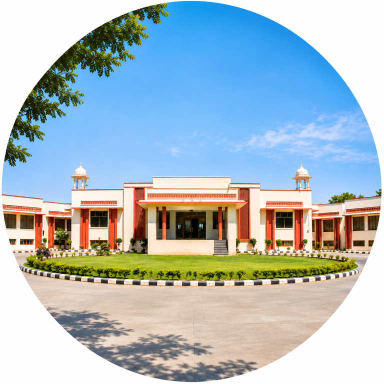
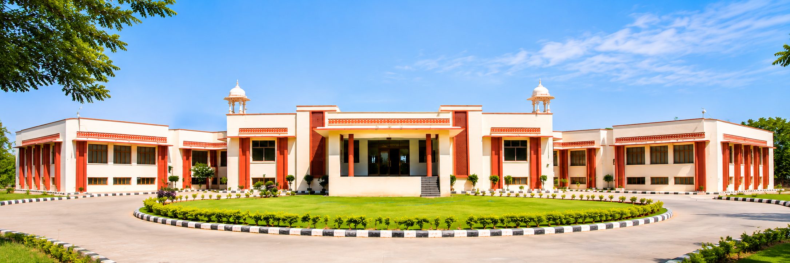
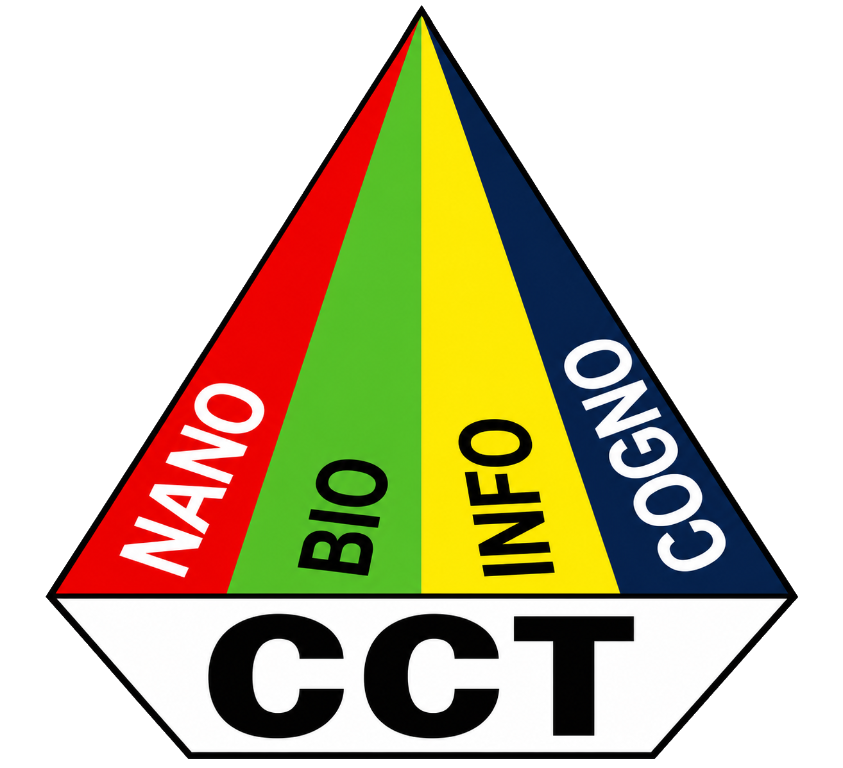
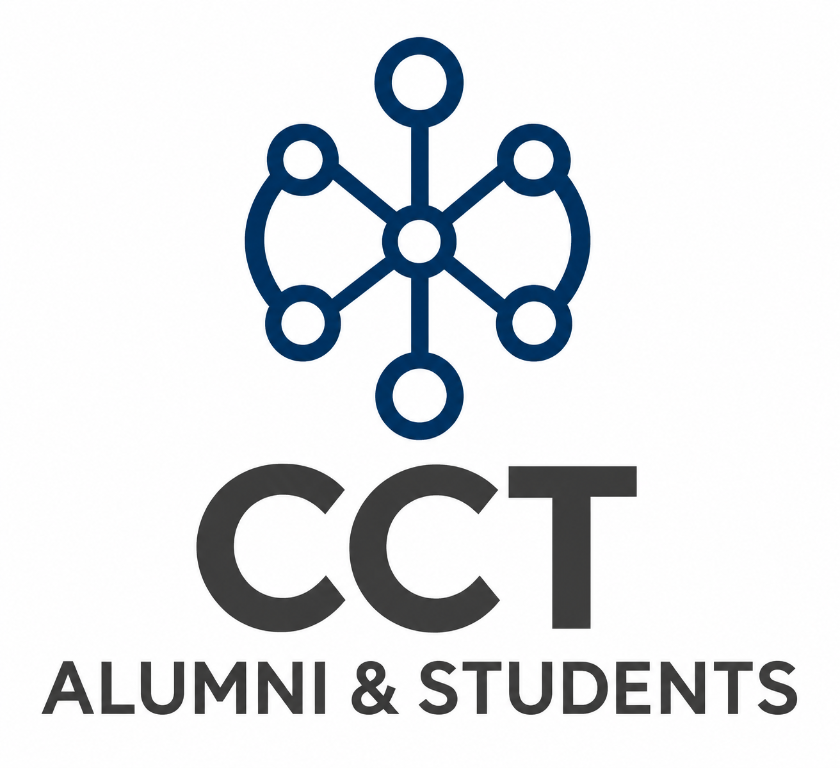

# CONVERGENCE 2026 — Official Website
**Centre for Converging Technologies (CCT), University of Rajasthan, Jaipur**

<table>
  <tr>
    <td width="18%" align="center"></td>
    <td width="82%"></td>
  </tr>
</table>

National Interdisciplinary Symposium on Converging Technologies (Nano, Bio, Info, Cogno).

- **Dates:** November 28–29, 2026
- **Venue:** CCT, University of Rajasthan, Jaipur
- **Invited Alumni Keynote:** Deepak Sharma (Foundation Manager, Jalte Diye Foundation) on *"Startup Engineering for Social Impact & Nurolab"*

---

## Website and source code

- **Live website:** [https://convergence26.github.io/](https://convergence26.github.io/)
- **Source repository:** [https://github.com/convergence26/convergence26.github.io](https://github.com/convergence26/convergence26.github.io)

To edit the website on your computer, download or clone the repository, open the folder in a code editor such as Visual Studio Code, and edit `index.html`. Keep the image folders and image files with the page. Open `index.html` in a browser to preview your local changes.

Local edits do not change the live website. Publishing changes requires write access to the source repository and pushing the updated files to its configured GitHub Pages branch.

---

## 🤝 Open Source Contributions
We gratefully acknowledge CCT alumni and students for their participation and valuable contributions to Convergence 2026 and this project.

This project is open-source so that CCT students, alumni, and committee members can contribute sessions, schedule updates, speaker profiles, and paper guidelines. Use the source repository link above to browse or contribute changes.

Connect with the CCT community on LinkedIn:

- [CCT LinkedIn page](https://www.linkedin.com/company/centre-for-converging-technologies-uor-jaipur)
- [Private LinkedIn group: CCT Alumni and students](https://www.linkedin.com/groups/16857007/)

| CCT | CCT Alumni and Students |
| --- | --- |
|  |  |

## Credits

Website management and development credit goes to CCT alumni & students for their participation and contributions.

| Contributor | Contribution |
| --- | --- |
| [Deepak Sharma](https://github.com/depthgr8) | UI/UX and website/flyer management |
| [Sarthak](https://github.com/sarthak2633u) | Web development |
| [Pranav](https://github.com/gaurpranav-neuro), [Prince](https://github.com/Prince1904247) & [Maitri](https://github.com/maitrz) | Content curation and information validation |

#### Under the supervision of Prof. Neelima Gupta, Director, CCT, UoR
