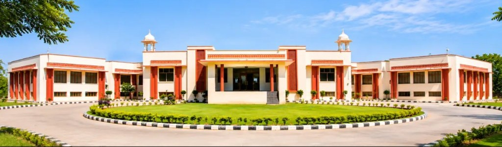

# Convergence 2026 - Website's source repository

**Centre for Converging Technologies (CCT), University of Rajasthan, Jaipur**

National Interdisciplinary Symposium on Converging Technologies (Nano, Bio, Info, Cogno).

- **Dates:** November 28–29, 2026
- **Venue:** CCT, University of Rajasthan, Jaipur

## Open source contributions

We gratefully acknowledge CCT alumni and students for their participation and contributions to CONVERGENCE 2026 and the CCT community.

This project is open source. CCT students, alumni, and committee members are welcome to contribute updates to sessions, schedules, speaker profiles, posters, and paper guidelines. Use the source repository above to browse the code or contribute changes.

Connect with the CCT community: [CCT on LinkedIn](https://www.linkedin.com/company/centre-for-converging-technologies-uor-jaipur)

## Website and source code

**Live website:** [convergence26.github.io](https://convergence26.github.io/)
**Source code:** [convergence26.github.io](https://github.com/convergence26/convergence26.github.io)

## Credits

#### Made with ❤️ by CCT Alumni and Students.

| Contributor | Contribution |
| --- | --- |
| [Deepak Sharma](https://www.linkedin.com/in/deepaksharmaa/) | Management and development of UI/UX  for digital assets (website/flyer/etc.)|
| [Sarthak Yadav](https://www.linkedin.com/in/sarthak-yadav-758296423/) ([GitHub](https://github.com/sarthak2633u)) | Web development and UI design |
| [Pranav Vats](https://www.linkedin.com/in/pranav-gaur-ba348b306/) ([GitHub](https://github.com/gaurpranav-neuro)), [Prince](https://www.linkedin.com/in/prince-raj-singh-rathore-b47727414/) ([GitHub](https://github.com/Prince1904247)) & [Maitri](https://www.linkedin.com/in/maitri-srivastava-53896a439/) ([GitHub](https://github.com/maitrz)) | Content curation, Information management and Validation |

**Under the leadership of Dr. Yogesh Joshi (Director, CCT, UoR) and Prof. Neelima Gupta (Convener, Convergence 2026).**

## Would like to contribute?

To edit the website locally, clone or download this repository, then edit `index.html` in a code editor such as Visual Studio Code. Keep the image folders and files alongside the page. Open `index.html` in a browser to preview your changes.

To preview the flyer viewer locally, run `python -m http.server 8000` in the repository folder and visit `http://localhost:8000`. The viewer requires an internet connection to load PDF.js.

Local edits do not change the live website. Publishing requires write access to this repository and pushing changes to its GitHub Pages branch.
